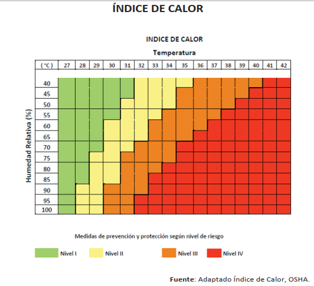

# INTRODUCCION

## INDICE DE CALOR (IC)

El índice de calor es la sensación térmica que experimenta el cuerpo al combinar la temperatura del aire y la humedad relativa, se necesitan dos varibles principales(Decreto N.º 39147-S-TSS, 2015):

1.  Temperatura del aire (en grados Celsius o Fahrenheit).
2.  Humedad relativa (en porcentaje %).

De conformidad con el estudio realizado por la Caja Costarricense de Seguro Social, denominado ***“Factores Asociados a Enfermedad Renal Crónica, Región Chorotega año 2014”***, se concluye que en Costa Rica, la ERCnT, tiende a ser mayor en hombres jóvenes que se dedican a trabajos físicos y se concentran en comunidades de la provincia de Guanacaste (Caja Costarricense de Seguro Social \[CCSS\], 2014).

Este documento permite estimar el **índice de calor** con una base de datos que incluye **las varibles de temperatura y humedad** en este caso de forma exclusiva para la ciudad de Liberia Guanacaste tomando de referencia la **Estación del Aeropuerto del Liberia**, a partir de los datos brindados por Climate Hazards Group InfraRed Precipitation with Station data \[CHIRPS\] y descargados de las bases de datos disponibles en **El blog de Franz** (Leonardo, s. f.)

Cabe mencionar que para obtener el índice de calor se debe tomar de referencia la siguiente imagen:

{fig-align="center" width="400"}

Con la información anterior se desea conocer:

1.  Efecto multiplicador de la humedad, meses con temperaturas más altas (\>28°C) y mayor % de humedad (\> 75%)

2.  Meses del año 2025 con el % de humedad relativa ideal (\<60%)

3.  meses con el IC más alto del 2025?

# IMPORTACIÓN Y PREPARACIÓN DE LOS DATOS

## CARGA DE DATOS

```{r}
#| label: carga-datos
#| message: false

library(tidyverse)
library(dplyr)
library(plotly)
library(DT)
i_calor <- read_csv("https://raw.githubusercontent.com/dani10movister-bot/tarea-02/refs/heads/main/bd_tarea-02_3.csv")

i_calor
#head(i_calor)

```

## DESCRIPCIÓN DE DATOS

```{r}
#| label: glimpse y dim

glimpse(i_calor) 
dim(i_calor)

```

# DT

## TABLA DE DATOS INTERACTIVA

```{r}
#| label: DT-1
#| echo: true
#| message: false

i_calor |>
  datatable(
    rownames = FALSE,
    options = list(
      pageLength = 10, 
      autoWidth = TRUE,
      language = list(url = "https://cdn.datatables.net/plug-ins/1.10.11/i18n/Spanish.json")),
    caption = htmltools::tags$caption(
      style = 'caption-side: top; text-align: center; font-weight: bold;',
      'Tabla 1: Datos de temperatura y humedad (CHIRPS) - Enero a Diciembre 2025'
    )
  )

```

# TRANSFORMACIÓN DE DATOS

## MESES CON TEMPERATURA \> 28 °C y %HUMEDAD RELATIVA \> 75 %

Muestra tanto altas temperaturas como alto % de humedad, lo que aumenta la sensación de calor, aire saturado de vapor de agua, grado de riesgo categorías II y III.

```{r}
#| label: IC_GR_II

filter(i_calor, t_mean > 28 & hr_mean > 75)
```

La tabla interativa permite observa el comportamiento de las variales detemperatura y humedad relativa para cada uno de los meses del periodo 2025. Permite ordenar cada variable en orden ascendente o descente, según corresponda.

## MESES CON HUMEDAD RELATIVA IDEAL \> 60 % IC_GR_II

Meses del año 2025 con el % de humedad relativa ideal, implica que se percibe más fresca la temperatura.No existen para el periodo 2025.

```{r}
#| label: IC_GR_II_1

filter (i_calor, hr_mean < 60)
              
```

## meses con IC EXTREMO % IC_GR_IV

Muestra de indice de calor extremo, grado de riesgo categoría IV.

```{r}
#| label: IC_GR_IV


filter (i_calor, t_mean > 28 & hr_mean > 80)
              
```

## DISTRIBUCIÓN DE TEMPERATURA POR MES EN LIBERIA,2025

```{r}
#| label: temp_mes
#| message: false
#| warning: false

nombres_meses <- c("Enero", "Febrero", "Marzo", "Abril", "Mayo", "Junio",
                   "Julio", "Agosto", "Septiembre", "Octubre", "Noviembre", "Diciembre")

par(mar = c(7, 4, 4, 2) + 0.1)

bp <- barplot(
  height = i_calor$t_mean,
  names.arg = nombres_meses,
  col = "#e66101",
  border = "gray20",
  ylim = c(0, 29),
  ylab = "Temperatura Promedio (°C)",
  main = "Temperatura Promedio Mensual (2025)",
  las = 2,       # Rota las etiquetas de los meses verticalmente
  cex.names = 0.9
)
```

## DISTRIBUCIÓN MENSUAL DE %HR PARA EL PERIODO 2025

```{r}
#| label: hr_mes
#| message: false
#| warning: false

nombres_meses <- c("Enero", "Febrero", "Marzo", "Abril", "Mayo", "Junio",
                   "Julio", "Agosto", "Septiembre", "Octubre", "Noviembre", "Diciembre")

par(mar = c(7, 4, 4, 2) + 0.1)

bp <- barplot(
  height = i_calor$hr_mean,
  names.arg = nombres_meses,
  col = "#e66101",
  border = "gray20",
  ylim = c(0, 100),
  ylab = "Humedad Relativa (%)",
  main = "% Humedad Relativa Media Mensual (2025)",
  las = 2,       # Rota las etiquetas de los meses verticalmente
  cex.names = 0.9
  
  )

```

# GRAFICO INTERACTIVO CON VARIABLES DE TEMPERATURA Y HUMEDAD RELATIVA

```{r}
#| label: temp_hr
#| message: false
#| warning: false

meses <- c("Enero", "Febrero", "Marzo", "Abril", "Mayo", "Junio",
           "Julio", "Agosto", "Septiembre", "Octubre", "Noviembre", "Diciembre")
i_calor$mes_nombre <- factor(i_calor$month, levels = 1:12, labels = meses)


plot_ly(
  data = i_calor,
  x = ~t_mean, 
  y = ~hr_mean,
  text = ~mes_nombre,
  type = "scatter",
  mode = "markers+text",
  textposition = "top center",
  marker = list(size = 12, color = ~t_mean, colorscale = "YlOrRd", showscale = TRUE)
) %>%
  layout(
    title = "Relación Temperatura promedio vs. Humedad Relativa promedio (2025)",
    xaxis = list(title = "Temperatura Promedio(°C)"),
    yaxis = list(title = "Humedad Relativa Promedio (%)")
  )
```

# REFERENCIAS BIBLIOGRÁFICAS

Costa Rica. Presidencia de la República, Ministerio de Salud & Ministerio de Trabajo y Seguridad Social. (2015, 23 de setiembre). Decreto Ejecutivo Nº 39147-S-TSS: Reglamento para la contratación de servicios de medicina del trabajo y seguridad e higiene en el trabajo. La Gaceta, (185), Alcance 75. <http://www.pgrweb.go.cr/scij/Busqueda/Normativa/Normas/nrm_texto_completo.aspx?param1=NRTC&nValor1=1&nValor2=80290>

Caja Costarricense de Seguro Social. (2014). Factores asociados a Enfermedad Renal Crónica, Región Chorotega: Informe final de resultados. Ministerio de Salud de Costa Rica. <https://www.ministeriodesalud.go.cr/index.php/biblioteca-de-archivos-left/documentos-ministerio-de-salud/tecno-ciencia/inventario-de-enfermedad-renal-cronica-no-tradicional-ercnt/estudios-de-ercnt-situacion-de-la-problematica-en-costa-rica/9654-factores-asociados-a-enfermedad-renal-cronica-region-chorotega-ccss/file>

Leonardo, F. (s. f.). CHIRPS \[Archivo temático de blog\]. Acolita: Geomática y Medio Ambiente. Recuperado el 27 de octubre de 2026, de <https://acolita.com/tag/chirps/>

# DECLARACIÓN DE USO DE IA

Se utilizó la herramienta Gemini para generar una primera versión de la función de descarga de datos y dar formato APA 7 a las referencias. Los resultados fueron revisados, verificados y adaptados por la persona autora.
